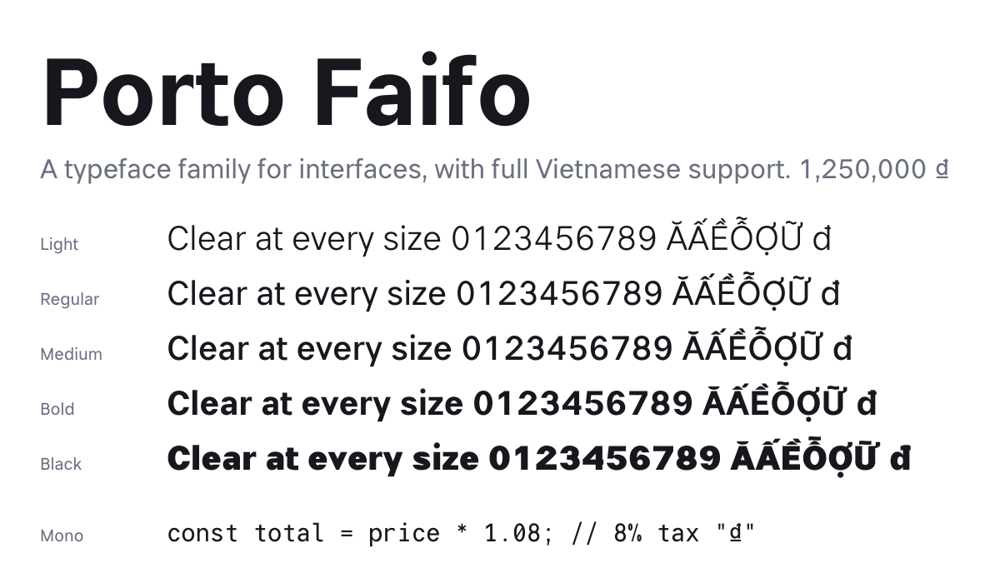
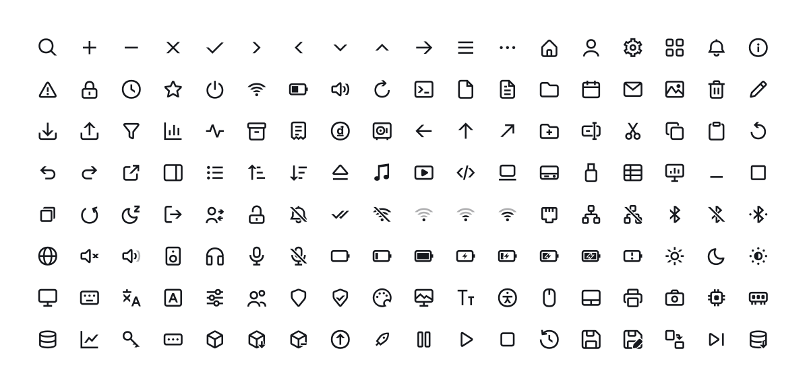

# Porto Faifo

Typefaces and symbols by [Két Việt](https://ketviet.vn) for user interfaces, with full Vietnamese support.

**[Download the latest release](https://github.com/ketvietlab/porto-faifo/releases/latest)**



| Family | Contents | Download |
| --- | --- | --- |
| **Porto Faifo Sans** | Light 300, Regular 400, Medium 500, Bold 700, Black 900; an optical-size (`opsz`) font per weight; a variable font (`wght` 300–900, `opsz` 8–72) | `PFSans-<version>.zip` |
| **Porto Faifo Mono** | Regular 400, Medium 500; every glyph 0.576 em wide | `PFMono-<version>.zip` |
| **Porto Faifo Symbols** | 322 SVG symbols (449 drawings with the filled variants), 14, 16, 20 and 24 px, four weights | `PFSymbols-<version>.zip` |

Both type families cover 530 code points: Google Fonts Latin Core, Latin Plus, Vietnamese and ₫.

## Installing the fonts

Unzip, then install the files in `OTF/` (macOS) or `TTF/` (Windows and Linux, hinted).
`Variable/` holds one file for every weight. Install either the static or the variable fonts, not both.

## On the web

```css
@font-face {
  font-family: "Porto Faifo Sans";
  src: url("PFSansVariable.woff2") format("woff2");
  font-weight: 300 900;
  font-display: swap;
}
body { font-family: "Porto Faifo Sans", system-ui, sans-serif; font-optical-sizing: auto; }
```

In the variable font, weight 600 renders as 500.

## Symbols



- Single files: `svg/<size>/<weight>/<name>.svg`; filled variants end in `-fill`.
- Sprites: `sprites/pf-symbols-<size>-<weight>.svg`, ids `pf-<name>`.
- `manifest.json`: names, aliases, groups, meanings, matching Lucide and freedesktop names.
- `preview.html`: every symbol on one page.

Each size is drawn with its own stroke, so use the matching size instead of scaling. Symbols follow
`currentColor` when the SVG is part of the page:

```html
<svg width="20" height="20" aria-hidden="true">
  <use href="pf-symbols-20-regular.svg#pf-search"></use>
</svg>
```

Lucide and freedesktop names are cross-references only; no Lucide geometry is used.

## Building from source

Python 3.11 is required. Library versions are pinned in `requirements.txt`.

```sh
python3.11 -m venv .venv
.venv/bin/pip install -r requirements.txt
.venv/bin/python scripts/release.py
```

The last command builds the fonts and symbols, runs the checks and writes the packages to `build/dist/`.

| Path | Contents |
| --- | --- |
| `design-system.json` | Parameters of both type families |
| `symbols/symbol-system.json` | Parameters of the symbols; strokes come from the fonts |
| `scripts/pfsans/`, `scripts/pfsymbols/` | Glyph and symbol drawing code |
| `sources/` | UFO3, generated from the parameters and the drawing code (do not edit by hand) |
| `fonts/`, `symbols/svg/`, `symbols/sprites/` | Build output |

## Releasing

1. Set `VERSION`, `meta.version` and `mono.version` in `design-system.json`
   (1.2.0 is written `1.200`), and `meta.version` in `symbols/symbol-system.json`.
2. Add a `## <version>` section to `CHANGELOG.md`.
3. Run `scripts/release.py`, commit the build output and push `main`.
4. Run `scripts/release.py --publish`: it rebuilds, checks, tags `v<version>` and creates the
   GitHub release with the packages and `SHA256SUMS.txt`.

## Licence

[SIL Open Font License 1.1](LICENSE.txt), for the fonts, the symbols and the source code in this repository.
